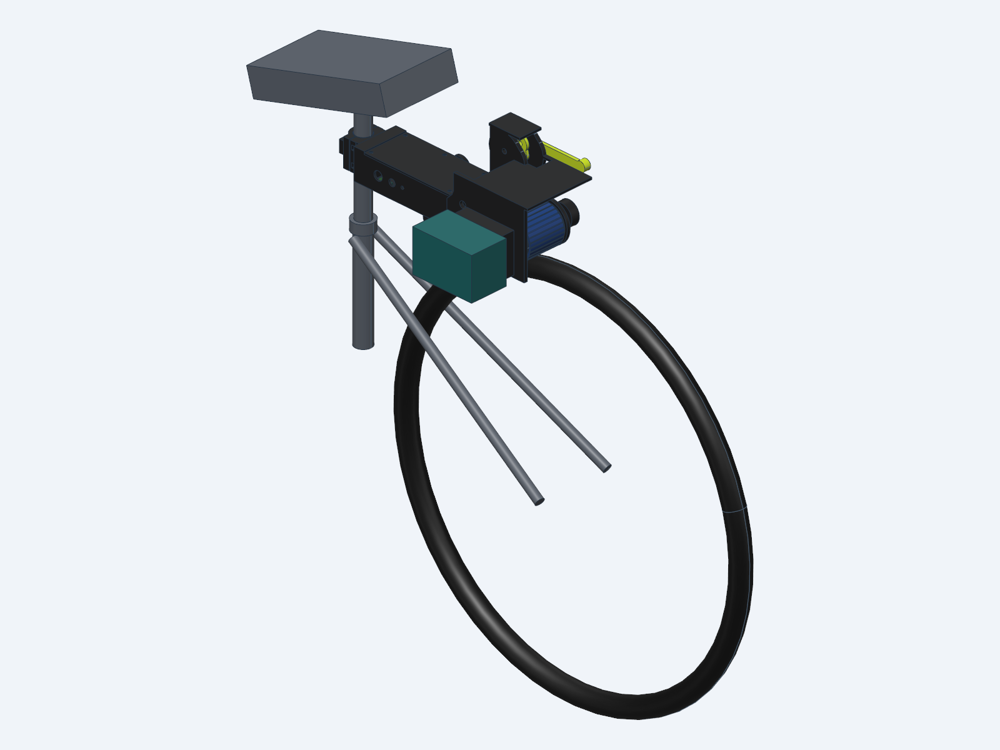
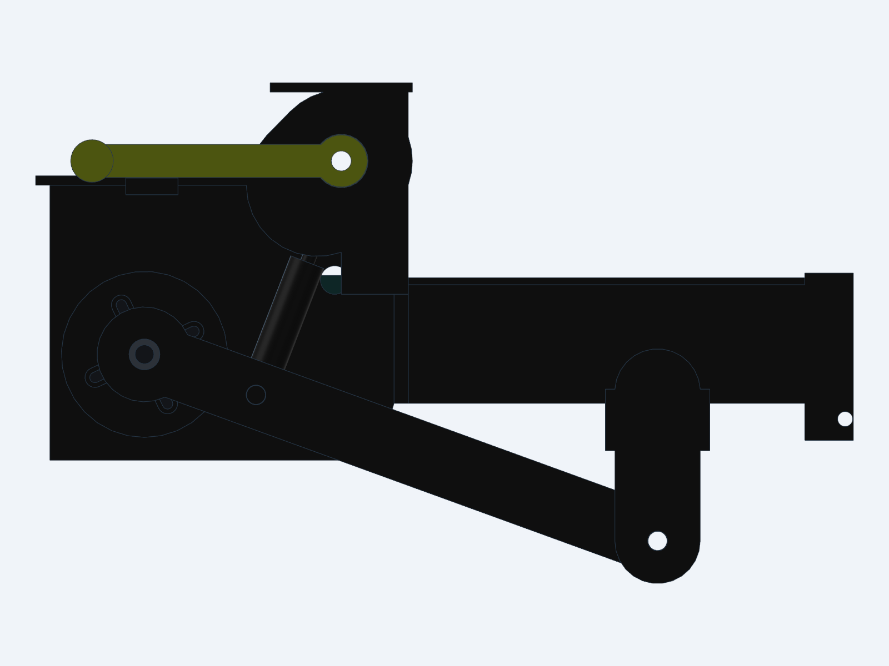
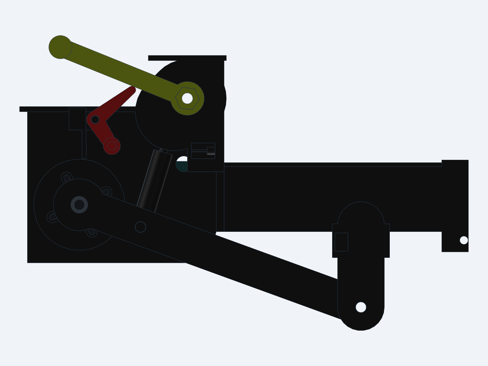

# PostRoller — 開源快拆摩擦助力器

把一台主機（馬達＋電控＋牧田 18V 電池）在不同腳踏車之間**免工具、十幾秒換裝**的摩擦驅動助力器：
每台車的座管上留一個便宜的 3D 列印座管座，主機往上一推、插一支快拆銷，扳下抬臂桿，
滾輪就以約 220 N 壓在後輪胎頂，踩踏時自動出力。



> **狀態：v0.3 設計版（2026-11-08）：v0.1 加上機械式緊急停止拉桿（v0.2），v0.3 把車把拉桿縮小約 40%，並依列印誤差約 0.2 cm 放寬緊急停止零件的配合。** 機構已在 CAD 中對 8 種車型做過裝車與干涉驗證、受力計算，
> 韌體可以編譯，但**還沒有實際列印、組裝、騎乘測試**。第一次組裝請把它當原型，先把車架起來空轉測試。

## 為什麼不直接用現成的開源專案

做之前調查了 13 個公開的摩擦驅動專案（GitHub、Thingiverse、Printables、Hackaday、Endless-Sphere…，
完整報告見 [docs/research/opensource.md](docs/research/opensource.md)）。
**沒有一個同時做到：免工具換車、以 PETG 類列印為主、零件在台灣買得到、開放授權。**

- 快拆做得最好的 Bicycle BoosterPack 是付費 STL、不可改作。
- 授權乾淨、有原始檔的 MikeKaiser/eBike_v1（MIT）與 BijouBoost（GPL-3.0）都要用螺栓鎖死。
- 最新的 JK_Prints（2026、CC BY-SA）只有 STL、也是螺栓固定。

所以 PostRoller 是重新設計的，採用了這些專案與市售品的經驗：
- 每台車留底座、主機輪流用（Piotr F-drive、Rubbee X）。
- 定力氣壓彈簧約 200 N（Rubbee X）。
- 擺臂樞軸用密封軸承、要有上下限位（Kepler）。
- 座管夾要精準配合管徑，不要靠墊片湊合（Kepler eBoost 鬆脫撞輪的教訓）。
- 列印參數參考 JK_Prints（0.6 噴嘴、厚牆）。

## 規格

| 項目 | 規格 |
|---|---|
| 驅動 | 6374 外轉子無刷馬達（170KV、有感），外殼套 3 mm TPU 95A 滾輪套（Ø69）直接壓胎頂 |
| 電控 | VESC（Makerbase MKSESC MINI V6.7 50A），FOC |
| 電池 | 牧田 18V（5S）電池，主機右側滑軌座，隨插隨拔 |
| 控制 | 踏頻助力（不是油門）：藍牙踏頻感測器（Magene S3+ 等標準 BLE CSC）綁在曲柄，ESP32-C3 讀踏頻後命令 VESC；**車上不用接電線** |
| 緊急停止 | 車把上的紅色拉桿（純機械，一條煞車線）：一拉，主機上的觸發桿把抬臂機構頂過死點，氣壓棒自己把滾輪抬離輪胎；停了會鎖住，要回主機旁把把手壓回去才恢復。見 [05 緊急停止拉桿](docs/05_緊急停止拉桿.md) |
| 速限 | 22 km/h 起遞減、25 km/h 斷電；停止踩踏約 1–2.5 秒內斷電 |
| 壓胎力 | 定力氣壓棒 250 N → 正向力 216–237 N（8 種車型差 ±5%），可換 200/300 N |
| 可傳推力 | 乾地 110–152 N、濕地 62–72 N（25 km/h 巡航只需 36 N，6% 爬坡約 58 N） |
| 列印件 | 主機約 1.01 kg（PETG-CF 為主），每台車的座管座約 0.1 kg |
| 整機重 | 約 2.9 kg（含馬達 0.98 kg、牧田 5Ah 電池約 0.63 kg） |
| 估計成本 | 零件約 NT$7,300–7,800（不含電池、充電器），見 [零件與採購](docs/01_零件與採購.md) |

## 怎麼運作



1. **座管座**（每台車一組）：兩片式夾具＋TPU 內襯鎖在座管上，背面是一條 45° 燕尾。依車型有 4 款
   （傾角 0°／−10°／+10°／+30°），讓主機在每台車上的擺臂角度都落在同一個工作點。
2. **主機**由下往上滑進燕尾、頂到上止擋；燕尾下方插 Ø6 球鎖快拆銷鎖住。
3. **擺臂**（樞軸兩顆 608 軸承）末端裝 6374，**氣壓棒**把擺臂往下壓、滾輪壓到胎頂。
4. **抬臂桿**是過死點偏心機構：往前扳，氣壓棒伸到底變成拉桿，把滾輪抬離輪胎 18–38 mm（下長坡、不需要助力、裝卸時用）；
   往後扳回，滾輪壓回輪胎並鎖定。扳桿最大手力約 40 N。
5. **緊急停止**：車把上的紅色拉桿經煞車線拉動主機上的觸發桿，從下面把抬臂把手頂過死點，氣壓棒就自己把滾輪抬起（純機械，不靠電）。



## 適用車型

用 bikeinsights 上的實車幾何做 CAD 裝車檢查（`src/check_bikes.py`），**8 種全部可以裝**：

| 車型（代表車款） | 座管 | 座管座款式 | 夾具高 s* | 擺臂角 | 離座墊 | 最小間隙 |
|---|---|---|---|---|---|---|
| 公路 700×28（Specialized Allez 56） | 27.2 | std | 40 | −18.2° | 69 mm | — |
| 礫石 700×40（Canyon Grizl M） | 27.2 | std | 46 | −21.3° | 45 mm | — |
| 城市 700×35（Trek FX 2 M） | 27.2 | std | 110 | −20.2° | 57 mm | — |
| 登山 29×2.3（Trek Marlin 7 M） | 31.6 | mtb | 124 | −17.5° | 60 mm | 6 mm（座管） |
| 登山 27.5×2.4（Marlin 7 S） | 30.9 | mtb | 140 | −19.5° | 45 mm | 6 mm（座管） |
| 老登山 26×1.95（Hardrock M） | 27.2 | std | 74 | −20.4° | 91 mm | — |
| 小徑 20×1.75（Tsunami D20 L） | 27.2 | minivelo | 40 | −22.5° | 104 mm | 7 mm（後上叉） |
| 折疊 20×1.75（估計幾何） | 33.9 | fold | 72 | −20.3° | 178 mm | 8 mm（座管） |

\* s = 夾具中心離立管上緣（座管束頂面）的距離。

**你的車：** 量兩個距離後執行 `python tools/fit_my_bike.py measure ...`，
工具會告訴你該印哪一款座管座、夾具裝多高（用法寫在檔案開頭）。

**不支援：** 碳纖座管（夾具壓力會傷管）、升降座管、D 形或氣動座管（如 Giant D-Fuse，請換一支便宜的圓形鋁座管）、
全避震車、外露座管太短（少於約 120 mm）的車；後貨架、後擋泥板要先拆掉。

## ⚠ 台灣法規：只能在私人場地使用

台灣的電動輔助自行車必須是業者送審、取得型式審驗合格標章的**完成車**。
法規沒有讓個人為外掛套件申請審驗的管道。

自行在腳踏車加裝馬達騎上道路，可能被認定為拼裝車：
- 依道安規則 §119 第 4 項，處罰條例 §12 可罰 3,600–36,000 元，並移置保管、沒入。
- 也可能適用 §71「未經型式審驗之電動輔助自行車…沒入之」。

本專案依電動輔助自行車的技術基準做了這些限制：只有踏頻助力、沒有油門、25 km/h 斷電、輸入功率約 360 W 以下。
**但做到這些仍然不會讓它變合法。** 請只在不供公眾通行的私人場地使用，條文與出處見 [docs/research/regulation.md](docs/research/regulation.md)。
未審驗的車沒有強制險，事故責任自負。

## 文件

| 文件 | 內容 |
|---|---|
| [01 零件與採購](docs/01_零件與採購.md) | 馬達詳細規格、電控、電池、感測器、五金；蝦皮／露天／淘寶搜尋關鍵字與價格 |
| [02 列印](docs/02_列印.md) | 每個零件的材料、擺放方向、支撐、切片設定、克數與時間；座管座怎麼選 |
| [03 組裝與接線](docs/03_組裝與接線.md) | 組裝步驟、接線圖、VESC 設定、韌體燒錄、裝車與使用、保養 |
| [04 設計說明](docs/04_設計說明.md) | 為什麼這樣設計：幾何最佳化、自增壓的限制、氣壓棒與偏心機構、受力、已知限制 |
| [05 緊急停止拉桿](docs/05_緊急停止拉桿.md) | 原理、規格、零件、每台車的安裝、換車時的連接與測試、觸發後怎麼恢復 |
| [docs/research/](docs/research/) | 開源專案、馬達電控、電池控制、自行車規格、台灣法規的調查報告（含查證） |

## 檔案結構

```
src/        build123d（cadgen 0.8.3）參數化模型、檢查與匯出腳本
  params.py       所有尺寸與車型資料
  base.py         座管座、TPU 內襯
  unit.py         主機各件＋外購件佔位
  bikes.py        8 種車型治具與裝車組件
  check_unit.py   擺臂全行程干涉檢查
  check_bikes.py  8 車型裝車檢查
  forces.py       正向力、可傳推力、扳桿手力
  estop_lever.py  車把上的緊急停止拉桿（3 種管徑、左右鏡像）
  check_estop.py  緊急停止：觸發角、拉線行程、干涉
  estop_calc.py   緊急停止：過死點力矩、自鎖檢查
  export_print.py 匯出列印擺放好的 STL、組件 STEP
  slice_parts.py  Bambu Studio CLI 切片估重
STL/        列印檔（已擺好方向；estop_lever/ 是車把拉桿）  STEP/  組件 STEP（含外購件佔位）
PRINT/      參考切片（A1；0.6 硬化鋼噴嘴／PETG-CF、0.4／TPU）
firmware/   ESP32-C3 韌體（PlatformIO）
tools/      fit_my_bike.py：我的車能不能裝
analysis/   幾何與接觸力學最佳化
vendor/     CC0 牧田電池座（fablab.ee）與端子（axel）
```

改尺寸：改 `src/params.py`，執行 `cadgen +0.8.3 run src/check_unit.py`、`src/check_bikes.py` 確認，
再執行 `src/export_print.py` 匯出 STL。

## 授權

- 硬體設計（CAD、STL、STEP）與文件：**CC BY-SA 4.0**
- 韌體 `firmware/`：**GPL-3.0-or-later**（因為連結 GPL-3.0 的 VescUart）
- `vendor/makita_cc0/`：原作者以 CC0 釋出（fablab.ee、axel）

詳見 [LICENSE.md](LICENSE.md)。
