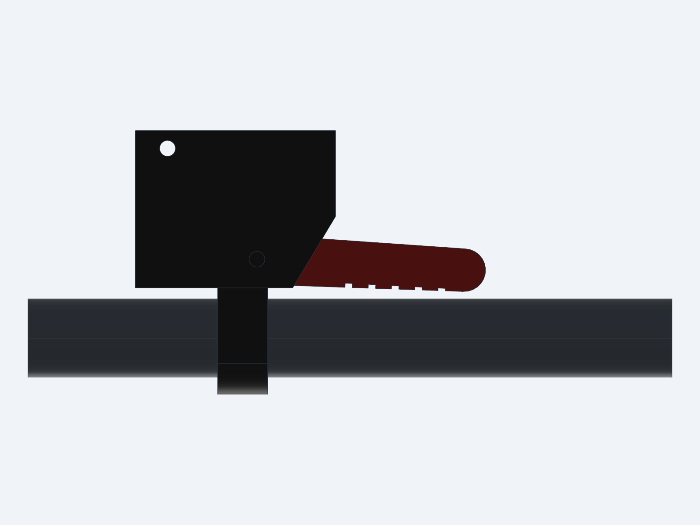

# 05 緊急停止拉桿（機械式，v0.2）



## 它做什麼

車把上裝一支紅色拉桿，用手指往身體方向一拉，**滾輪就被抬離輪胎**，助力在物理上中斷。
- **不靠電**：馬達、電控、ESP32、韌體不管發生什麼故障，都能停。
- **停了會鎖住**：拉桿放開後也不會自己恢復。要回到主機旁，把抬臂把手壓回去才會再接上。
- **騎乘中也能用**：例如長下坡（車速超過約 48 km/h 時馬達會回灌電池）前，不用伸手到座墊後面，在車把上一拉就能放開驅動。

## 原理

```
紅色拉桿 ──煞車線──▶ 主機上的觸發桿 ──頂──▶ 抬臂把手過死點 ──▶ 氣壓棒自己把滾輪抬起
```

1. 主機的抬臂機構是過死點偏心：工作位置時，曲柄過死點 6°，被氣壓棒壓在擋塊上（鎖緊力矩 0.53–0.58 N·m）。
2. 拉線拉動觸發桿（主機左後方，抬臂把手下面），頂墊從下面把把手往上頂。
3. 觸發桿轉 32° 時，把手被頂到 22°，也就是過死點 16°。
   - 這時氣壓棒推曲柄的力矩約 1.2 N·m，比曲柄軸的估計摩擦（約 0.5 N·m）大兩倍以上。
   - 曲柄會自己繼續轉，氣壓棒伸到底，正向力歸零，擺臂把滾輪抬起。
4. 過了死點以後，氣壓棒只會往「抬起」方向推，所以停住後不會自己回去。8 種車型都算過，見 `src/estop_calc.py`。

## 規格（`src/check_estop.py`、`src/estop_lever.py`）

| 項目 | 數值 |
|---|---|
| 主機端拉線行程 | 12.7 mm（觸發桿轉 32.4°） |
| 車把端拉線行程 | 14.4 mm（拉桿轉 33°；多 1.7 mm 給線管壓縮與鬆弛） |
| 主機端拉線張力 | 約 47 N（保守估計，含曲柄軸摩擦 0.5 N·m）；曲柄軸上潤滑油約 34 N |
| 手指力 | 約 38 N（煞車線管效率以 75% 計、手指在拉桿中段）；上油後約 28 N |
| 反應時間 | 手指拉到底約 0.15 s ＋ 氣壓棒把曲柄推開 < 0.2 s（氣壓棒伸出速度未實測） |
| 干涉檢查 | 觸發桿 0–40°、已停止狀態、拉桿 0–38° 全部零干涉；8 種車型裝車間隙不變 |

## 零件

**主機端（印一次）**

| 檔案 | 材料 | 說明 |
|---|---|---|
| `STL/unit/10_estop_kicker_PETG-HF.stl` | PETG HF（可以的話用紅色），100% 填充 | 觸發桿（5.0 g、17 分） |
| `STL/unit/09_spacer_kicker_x1_PETG-HF.stl` | PETG HF 100% | 觸發桿軸的墊管 |
| `STL/unit/02_housing_rear_PETG-CF.stl` | 已含觸發桿支架、拉線休止擋、塔外牆的線管座 | |
| `STL/unit/01_housing_front_PETG-CF.stl` | 已含外耳板外側的線管扣 | |

**車把端（每台車一支）**

| 檔案 | 材料 | 說明 |
|---|---|---|
| `STL/estop_lever/L/estop_lever_upper_bar<管徑>_L_PETG-CF.stl` | PETG-CF 60% | 上件：夾環＋上板，平面朝下免支撐（17.7 g、54 分）。管徑有 22.2、23.8、25.4 |
| `STL/estop_lever/L/estop_lever_lower_L_PETG-CF.stl` | PETG-CF 60% | 下件：下板＋線管座，免支撐（13.1 g、36 分） |
| `STL/estop_lever/L/estop_lever_blade_L_PETG-HF.stl` | PETG HF（紅）100% | 拉桿片（9.8 g、23 分） |

`L` 裝在車把左半邊，`R` 是鏡像版，裝右半邊。

**外購**

| 零件 | 數量 | 備註 |
|---|---|---|
| MTB 煞車內線（Ø1.5，一端有圓柱線頭 Ø6×7） | 每台車 1 | 圓柱線頭裝在拉桿端 |
| 5 mm 煞車線管＋線管頭 2 個 | 每台車約 1.5 m | 長度依車而定 |
| 免焊螺絲線頭（剎車線頭） | 每台車 1 | 裝在主機端，可以任意位置鎖死，用來調鬆緊 |
| M4 熱壓銅螺母＋M4×14＋墊圈 | 主機 1 組 | 觸發桿的軸：螺絲夾住墊管 `09_spacer_kicker`（Ø6×6），觸發桿套在墊管上轉 |
| M4×20＋防鬆螺帽 | 每支拉桿 1 | 拉桿樞軸（鎖到拉桿能順順擺動即可） |
| M4×20＋防鬆螺帽 | 每支拉桿 1 | 上下件接合 |
| M4×16＋螺帽 | 每支拉桿 1 | 夾具鎖緊 |
| 束帶 | 數條 | 線管沿車把、上管、立管固定 |

## 安裝（每台車一次）

1. **裝拉桿**：
   - 把上下件與拉桿片用兩支 M4×20（樞軸、接合）組起來，樞軸的防鬆螺帽鎖到拉桿可以順順擺動、不晃。
   - 夾在**龍頭附近的空車把**上，也就是現有變速把、煞車把的內側；拉桿片朝外、在車把下方。
   - M4×16 鎖緊夾具。
2. **裝內線（拉桿端）**：
   - 把拉桿拉到底，圓柱線頭從上件的安裝孔放進拉桿片的線頭座。
   - 放開拉桿，線頭就被上板擋住，不會掉出來。
   - 內線從下件的線管座往內側穿出。
3. **走線管**：線管頭插進下件的線管座，沿車把、龍頭、上管或下管、立管用束帶固定，一路到座管束附近。
   - 預留的長度要能在主機裝上後：
     - 先卡進主機前段外耳板外側的線管扣，
     - 再往後接到主機左後方塔外牆的線管座。
   - 長度要等主機裝上車後再決定，裁切後裝上線管頭。
4. **調鬆緊（主機端）**：
   - 主機裝在車上、抬臂把手在工作位置、觸發桿靠在休止擋上。
   - 把免焊螺絲線頭鎖在內線上適當位置，讓線頭放進觸發桿的線頭座後，內線大約有 **1 mm 鬆弛**。
   - 太緊：會一直頂著觸發桿。
   - 太鬆：拉桿要拉更多才觸發（拉桿拉到 38°、拉線 16.3 mm 時仍不干涉，有餘裕）。

## 每次換車（多約 5 秒）

1. 照平常步驟把主機裝上座管座：抬臂把手往前扳起、滑入、插快拆銷、插電池。
2. 線管卡進前段的線管扣。
3. 線管頭壓進塔外牆的線管座（側面開縫，壓進去會卡住）。
4. 內線的螺絲線頭從外側放進觸發桿下端的線頭座。
5. 抬臂把手往後扳回工作位置。
6. **測試**：拉一下紅色拉桿，抬臂把手應該彈起、滾輪抬離輪胎。確認後再把抬臂把手扳回去。

**沒接上拉線就沒有緊急停止。** 每次換車都要做第 6 步。

## 觸發之後怎麼恢復

1. 停車。
2. **先把助力段位按回 0，或關掉電控艙的助力總開關。**
   - 這版是純機械式，觸發後馬達電源沒有被切斷。
   - 如果還在踩踏，韌體會繼續送電流，滾輪會在空中空轉（VESC 最高轉速已限制在約 30 km/h 對應的轉速）。
   - 推進一定已經中斷，但恢復前要讓滾輪停下來，不然壓回去時會撞輪胎、磨胎。
3. 到主機左後方，把抬臂把手壓回工作位置（靠到擋塊，約 40 N）。
4. 再重新選段位。

## 已知限制

- **曲柄軸摩擦是估計值**（塑膠孔配螺絲，約 0.5 N·m）。實際太大的話，觸發後曲柄可能停在半路。
  - 對策：曲柄軸、外轉轂上潤滑油或 PTFE 乾式潤滑。
  - 驗收：裝好後在車上反覆拉 20 次，每次都要彈到底。
- 氣壓棒伸出速度、煞車線管效率都是一般值，沒有實測。
- 不切電（依需求只做機械式）。之後如果要加電子斷電：在抬臂把手的擋塊下放一個微動開關，串在 ESP32 的 5 V 上。這樣把手一離開工作位置，VESC 就會在 0.3 秒內停止出力，空轉也一併解決。
